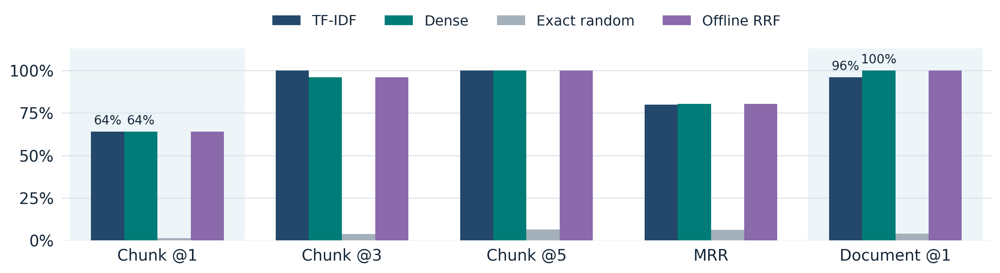
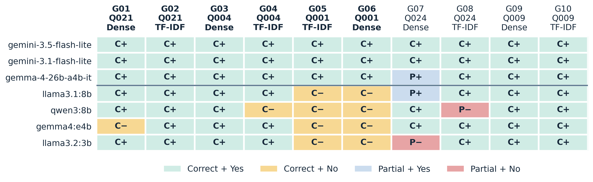

# Evidence retrieval and citation grounding

**A controlled RAG evaluation of Brazilian Portuguese technical documentation**

## Objective, corpus and traceable chunking (M1)

We measured retrieval, answer correctness and citation support on 25 reviewed documents (408 to 1,340 words) from `Madras1/rag-qa-fulltext-ptbr` (ODC-By). Each has one annotated question. The 83 NFC-normalized chunks use 300-word windows, 50-word overlap, character offsets and stable SHA-256 IDs. Gold chunks cover the annotated span. `data/MANIFEST.json` fixes the input hashes.

## Sparse and dense retrieval (M2)

TF-IDF with Unicode accent handling and dense Gemini embeddings (3,072 dimensions) rank all 83 chunks by cosine similarity. Chunk recall counts questions with a gold hit by rank k. MRR uses the first gold rank.

| Retriever | Chunk @1 | Chunk @3 | Chunk @5 | MRR | Doc. @1 |
| --- | ---: | ---: | ---: | ---: | ---: |
| TF-IDF | 0.640 | 1.000 | 1.000 | 0.800 | 0.960 |
| Dense | 0.640 | 0.960 | 1.000 | 0.803 | 1.000 |
| Exact random | 0.013 | 0.039 | 0.065 | 0.063 | 0.040 |
| Offline RRF (k = 60) | 0.640 | 0.960 | 1.000 | 0.803 | 1.000 |

*Figure 1. Both retrievers put gold first on 16 of 25 questions. TF-IDF put the right document first on 24 and dense did so on all 25. Treat the paired differences as descriptive at this sample size.*

## Controlled RAG and blind grading (M3 and M4)

Member B graded 10 answers per model with the retriever hidden. Five paired questions include the highlighted **Q021, Q004 and Q001**. Q004 holds the top-three set fixed and changes its order. Q009 holds the full prompt fixed. The models used K = 3, temperature 0, seed 42 and prompt `13c74fac6aa7`, developed on the default model alone. Ollama fixed context at 8,192 tokens, output at 1,024 and thinking off. The five questions support qualitative comparisons.

| Model | Provider | C / P / W | Supported | Gold cited | Median s |
| --- | --- | ---: | ---: | ---: | ---: |
| **gemini-3.5-flash-lite** | Gemini API | 10 / 0 / 0 | 10 | 9 | 5.0 |
| gemini-3.1-flash-lite | Gemini API | 10 / 0 / 0 | 10 | 9 | 1.9 |
| gemma-4-26b-a4b-it | Gemini API | 9 / 1 / 0 | 10 | 9 | 3.2 |
| llama3.1:8b | Ollama | 9 / 1 / 0 | 8 | 7 | 102.2 |
| qwen3:8b | Ollama | 9 / 1 / 0 | 6 | 6 | 107.9 |
| gemma4:e4b | Ollama | 10 / 0 / 0 | 7 | 6 | 34.2 |
| llama3.2:3b | Ollama | 9 / 1 / 0 | 7 | 7 | 45.1 |

Hosted models scored 29/30 Correct and 30/30 with citation support. Local models scored 37/40 Correct and 28/40 with support. Ten local answers were Correct with unsupported citations. Ollama ran on a CPU-only laptop.

## Failure analyses

*Figure 2. Cells pair the human grade with citation support. Bold columns mark the highlighted questions. At K = 3, the 70 answers received 66 Correct, 4 Partial and 0 Wrong grades.*

### 1. Missed evidence at the context cutoff

For Q024 (G07), dense placed `chk_D024_000_76a1bcf7` fourth, behind three other chunks from D024. Three models were graded Partial for omitting general layer filling or restricting Automapping to collision areas. `llama3.2:3b` also added the unsupported “reduzindo a complexidade do processo”. Four models gave Correct answers with support from the other chunks, which describe the TMX rules and automatic filling. Their answers expose the limits of a single annotated span.

In the separate Q019 development probe at K = 1, TF-IDF returned the Lightroom introduction and ranked the gold chunk third. The primary model abstained, which counts as Wrong under the rubric. Dense put gold first and correctly described the two clipping indicators. This probe sits outside the blind grades.

### 2. Unsupported citations with gold in context

For Q001 (G05/G06), gold was passage [1]. All four Ollama models cited [3] in both answers, consistent with copying slide number 3 beside the COBIT definition. Three answers appended invalid [4] or [17]. All eight were Correct with support graded No. The six hosted answers pointed to [1] with support.

For TF-IDF Q024 (G08), `qwen3:8b` cited the gold passage and received Partial with support graded No. It attributed “fronteiras de rios e barro” to Automapping. The quoted phrase refers to the previous tutorial's terrain-editing tool within that same passage.

## Search risk and proposed mitigation

Boilerplate and generic introductions can displace evidence within the right document. The target document was already first in 17 of 18 top-1 chunk misses, and RRF kept chunk recall@1 at 0.640. The one cross-document miss was TF-IDF Q005, where a QGIS download passage outranked the CSV/JSON evidence that uses “datasets” for “dados”.

Strip navigation and slide numbers, chunk by section with titles, then rerank a hybrid pool of five candidates with a cross-encoder before selecting three. Both original retrievers reached 25/25 recall at five. Use labels [C1] through [C3], validate the cited labels and preserve abstention. Test the proposal on held-out questions.

## Reproducibility

Run `python src/evaluate.py` and `python -m pytest`. The analysis uses saved files offline. Hosted answers can vary across generations at the same settings. [`notebooks/rag_evaluation.ipynb`](../notebooks/rag_evaluation.ipynb) · [`runs/m4_evaluation_summary.json`](../runs/m4_evaluation_summary.json)
